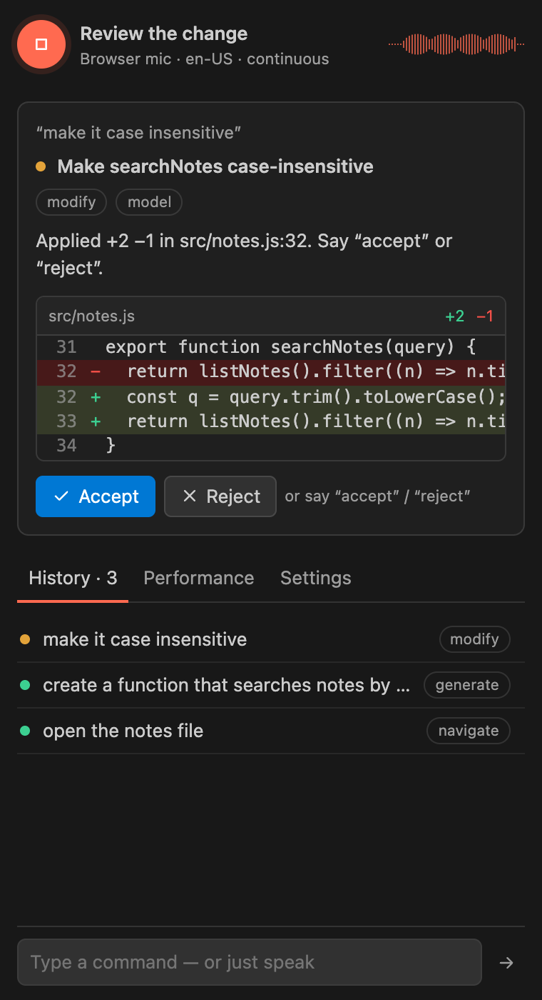
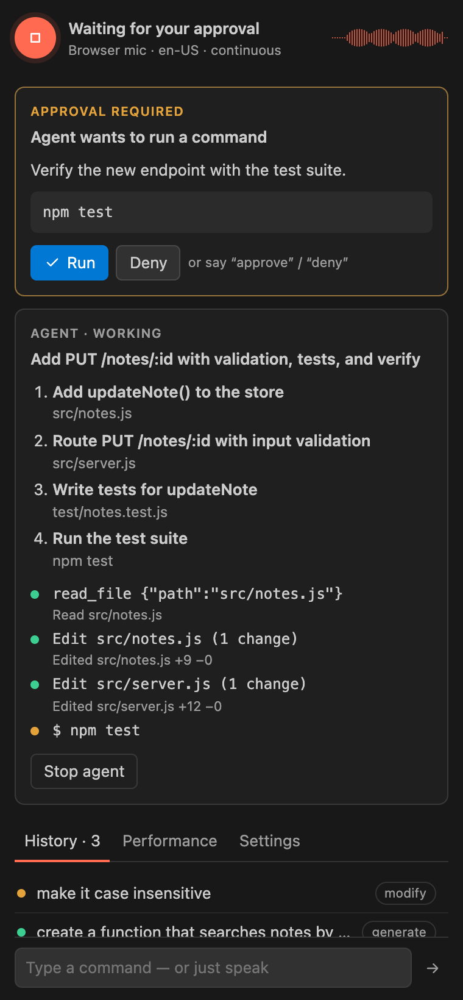
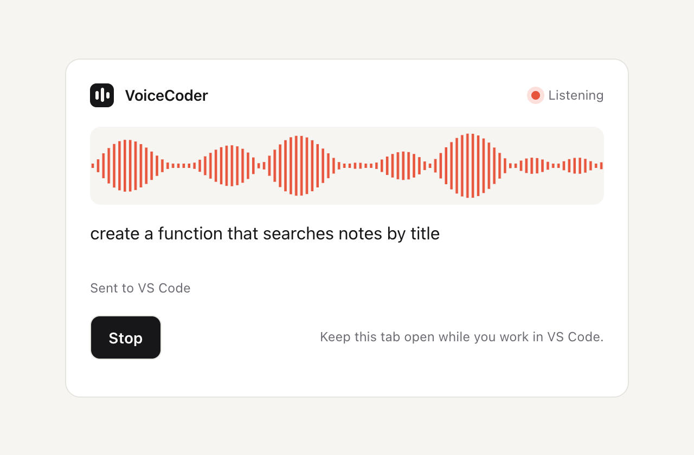
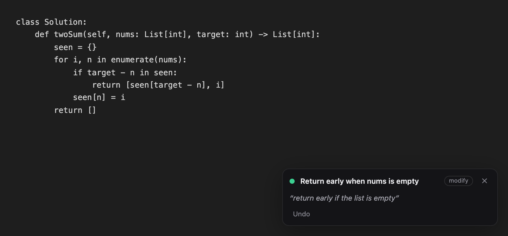
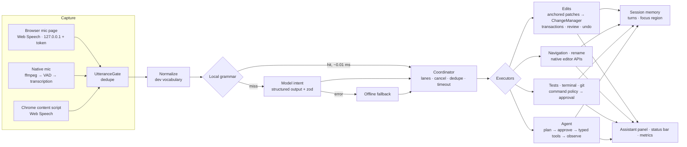

# VoiceCoder

**From voice to action.** Don't type your code. Don't type your prompts. Speak your intentions.

VoiceCoder is a voice-first development platform for VS Code and the browser. It does more than transcribe. It works out what you meant (navigate, write, change, refactor, debug, test, explain, run, commit, or a multi-step task) and then does it in your editor. Every change is minimal, reviewable and reversible.

```
“open the notes file”                         → opens src/notes.js            · local, <1 ms
“create a function that searches notes by title” → writes searchNotes() at the cursor
“make it case insensitive”                    → edits the function it just wrote
“run the tests”                               → asks to run `npm test`, runs it, reads the result
“fix the failing test”                        → reads the failure, diagnoses, patches, shows a diff
“accept”                                      → keeps the change
“generate a commit message” · “create a git commit” → writes it, asks, commits
```

<p align="center">
  
  &nbsp;
  
</p>
<p align="center"><sub>Assistant panel in VS Code: review a change (left) and agent mode waiting for approval (right). Rendered from the shipped webview bundle with demo state (<code>scripts/screenshots.ts</code>).</sub></p>

---

## Why it's different

| | Typical voice dictation | Typical AI coding assistant | **VoiceCoder** |
|---|---|---|---|
| Input | Speech → text | Typed prompts | Speech → **intent** |
| Simple commands ("go to line 45", "undo") | Typed out as words | Not applicable | Run locally in **<1 ms**, no model call |
| Changes | Inserts text | Often rewrites files | **Minimal anchored edits** with a diff, a review step and safe undo |
| Follow-ups ("make it async") | — | Re-explain the context | **Conversational memory**: knows what "it" is |
| Running things | — | Often auto-runs | **Policy check + explicit approval** for every command, commit and push |

## Features

**Voice**
- Real-time streaming transcription with live interim text, plus automatic speech detection (Web Speech API, or native ffmpeg + VAD + OpenAI transcription).
- Continuous and push-to-talk modes. English, Hindi and Telugu, depending on the speech engine (`en-US`, `en-GB`, `en-IN`, `hi-IN`, `te-IN`).
- Developer vocabulary correction: "jay w t" becomes JWT, "post gress" becomes PostgreSQL, "use effect" becomes useEffect, "jason" becomes JSON, "pie test" becomes pytest.
- Duplicate-proof. The original engine ran **33.3%** of utterances twice in simulation; the current pipeline ran **0%** (see [benchmarks](#benchmarks)).

**Understanding**
- A hybrid intent engine with 13 intent kinds: dictation, generate, modify, refactor, rename, debug, navigate, test, explain, terminal, git, agent and editor control.
- A deterministic local grammar handles closed commands (57% of the eval set) with 100% precision. Open-ended requests use **schema-validated structured output** from Claude or OpenAI, never keyword guessing alone. An offline fallback keeps VoiceCoder usable when no model is available.

**Editing (VS Code)**
- Context-aware: current file, selection, cursor, enclosing function (language server symbols), imports, diagnostics, project conventions and files.
- Changes are search/replace edits anchored on existing code, applied as the smallest ranges, so diffs stay small and output tokens low.
- Every change is a transaction. Accept, reject, undo and redo restore exact text, and **refuse** if you have edited since rather than overwrite your work.
- Results are bound to the file they were spoken in. If you switch editors mid-request, the change still lands in the right file. If the file changed underneath, anchored edits are rebased and cursor inserts are refused.
- Two review modes: *apply, then review* (default) and *preview first* (diff editor; nothing changes until you say "accept").

**Action**
- Debugging from compiler diagnostics and failing test output, with a diagnosis, root cause, minimal patch and diff.
- Tests: detects the project's runner (npm/pnpm/yarn, pytest, go, cargo, make), runs it after approval, summarises the result, and can generate tests.
- Terminal and git: run the app, install packages, status, diff, log, commit-message generation, commit and push. Git uses argv, never a shell.
- **Voice Agent Mode**: "create a REST API with authentication, add input validation, write unit tests, and run them" becomes a plan you approve, then typed tool calls (read, search, edit and write files, diagnostics, commands, git) with per-action approval, timeouts, retries, a step budget, cancellation and a final report.

**Interface**
- A minimal assistant panel with a live waveform, live transcript, status, streaming code preview, inline diff, accept/reject, agent progress, approvals, command history and on-device p50/p95 performance analytics.
- Native light, dark and high-contrast themes, keyboard shortcuts, settings and an onboarding walkthrough.
- A Chrome extension for browser editors (LeetCode, vscode.dev, CodeSandbox, StackBlitz, Replit, CodePen and more) with a shadow-DOM overlay.

<p align="center">
  
  &nbsp;
  
</p>

## Install

**Requirements:** Node 20+, VS Code 1.95+, and Chrome, Edge or Safari for the browser microphone, or ffmpeg for the native one.

```bash
git clone https://github.com/S-HEMANTH-REDDY/VoiceCoder.git
cd VoiceCoder
npm install
npm run build
```

**VS Code extension**
- Development: open the repo in VS Code and run the *Run Extension* launch target (`apps/vscode`). To install a package instead, run `npm run package -w voicecoder-vscode`, then use *Extensions → Install from VSIX…* with `apps/vscode/voicecoder.vsix`.
- Run **VoiceCoder: Set API Key…** for Anthropic or OpenAI. Navigation, undo, accept and git status work without a key.
- Press **⌥Space** (Alt+Space). The microphone page opens in your browser once; allow the microphone. To capture natively instead, set `voicecoder.speech.provider` to `native` (needs ffmpeg and an OpenAI key).

**Chrome extension**
- `npm run build -w @voicecoder/chrome`, then load `apps/chrome/dist` at `chrome://extensions` (Developer mode → Load unpacked).
- Add a key in the extension settings, click into an editor and press **⌥Space**.

## Demo: build and fix an app by voice

[`demo/notes-api`](demo/notes-api) is a dependency-free Node API with one planted bug. [`docs/DEMO.md`](docs/DEMO.md) is the full script: generate a function, refine it with a follow-up, run the tests, watch one fail, fix it by voice, generate tests, commit, then hand a multi-step task to the agent. Every step is spoken.

## Example voice commands

| Say | What happens |
|---|---|
| "go to line forty five" · "लाइन 45 पर जाओ" · "లైన్ 45 కు వెళ్ళు" | Cursor to line 45 (local) |
| "open the authentication file" | Fuzzy-opens `auth.ts` / `authController.ts` (local) |
| "go to definition" · "find all references" · "next error" | Native editor navigation (local) |
| "rename this variable to user count" | Language-server rename to `userCount` across files (local intent) |
| "create a login API" → "add JWT authentication" → "actually, use PostgreSQL" | Generate, then follow-up edits to the same code |
| "add error handling to this function" · "optimize this code" | Minimal edit of the enclosing function or selection |
| "explain this function" · "explain this error" | Streaming explanation in the panel |
| "fix the failing test" | Diagnosis + patch from diagnostics and the last failed run |
| "write unit tests for this function" · "run the tests" | Test file creation · approved test run with summary |
| "run the application" · "install axios" | Policy-checked, approved terminal command |
| "show git changes" · "generate a commit message" · "create a git commit" | Read-only git · message in the SCM box · approved commit |
| "undo my last change" · "accept" · "reject" · "cancel" · "approve" · "deny" | Instant control (local) |
| "type TODO handle pagination" | Literal dictation |

## Architecture



```
packages/core   @voicecoder/core: intent engine, speech controller, VAD, providers,
                patch protocol, transactions, memory, command policy, agent, metrics
apps/vscode     VS Code extension: native context, ChangeManager, executors,
                microphone providers, assistant webview, integration tests
apps/chrome     MV3 extension: page bridge (MAIN world), content script, overlay,
                service worker, real-browser compatibility tests
eval            144-command dataset, harness, results
demo            notes-api demo project
```

More detail: [docs/ARCHITECTURE.md](docs/ARCHITECTURE.md).

## Engineering decisions

- **Local first, model second.** Closed commands never pay for a network round trip. The grammar favours precision; a miss only costs one model call.
- **Flat schemas for structured output.** The model fills a flat, all-fields-present JSON schema (reliable across providers' constrained decoding). It is mapped and re-validated into a strict discriminated union. Nothing unvalidated reaches an executor.
- **Anchored minimal edits, not file rewrites.** Search/replace blocks tolerate indentation drift and CRLF, refuse ambiguous or stale anchors, and become small `WorkspaceEdit` ranges, which keeps VS Code's own undo, markers and folding intact.
- **Bind results to the target, verify before writing.** A command snapshots the URI, version and selection when spoken. Late results go to that document only, and only if it is still compatible.
- **Approval is structural, not a prompt instruction.** The executor layer cannot run a process, commit or push without the `ApprovalBroker` resolving `true`. The command policy blocks dangerous patterns before you are even asked.
- **Microphone in VS Code.** Webviews cannot capture audio, so VoiceCoder streams from a local browser page over a token-guarded loopback server, or captures natively with ffmpeg. Both paths are implemented.
- **Provider abstraction.** Executors depend on `LLMProvider`. The Anthropic provider uses the official SDK (prompt caching, streaming, server-side fallback); the OpenAI provider uses fetch. Defaults: `claude-opus-5-5` (low effort for intent, medium for edits) or `gpt-4.1`.

## Benchmarks

Measured on an Apple M3 (macOS), Node 22.11, VS Code 1.145.2. Reproduce with `npm run eval`, `npm run test:vscode` and `npm run test:browser -w @voicecoder/chrome`. Raw results are in [`eval/results`](eval/results).

| What | Result |
|---|---|
| Local command, end to end **in VS Code** (transcript → cursor moved, 60 commands) | **p50 0.54 ms · p95 0.84 ms** (target: <500 ms) |
| Local grammar classification (82 commands) | p50 0.013 ms · p95 0.18 ms |
| Commands handled with **no model call** (144-command set) | 56.9% · **100% precision** |
| Intent accuracy, local + offline fallback, no model | 90.3% (field accuracy on line numbers, targets and actions: 100%) |
| Duplicate execution, 500 simulated speech sessions (600 utterances) | Original engine **33.3%** → current **0%** (0 missed) |
| Edit application robustness (10 cases incl. re-indented, CRLF, ambiguous, stale) | 10/10 correct |
| Agent fault recovery (8 scripted faults: 429/5xx, bad args, timeouts, crashes, loops) | 8/8 handled |
| VS Code integration tests (real editor) | 18/18 passing |
| Real-browser editor compatibility (Monaco, CodeMirror 5/6, Ace, textarea, contenteditable) | 43/43 checks |
| Unit tests | 161 passing |

**Not yet measured.** No API key was available in the environment that produced these numbers, so **model-path intent accuracy, model latency, token use per command and code-edit success have not been measured**. Run `ANTHROPIC_API_KEY=… npm run eval -- --live` to measure them; the harness includes 10 executed-and-checked code-edit tasks. The offline fallback was tuned while building this dataset (there is no held-out split), so treat its 90.3% as an upper bound for unseen phrasing. Speech-engine recognition latency (browser/OS) is outside VoiceCoder and not included.

## Privacy and security

- **Keys:** VS Code Secret Storage, or the Chrome extension's local storage, read only by the background worker. Keys are never written to settings, logs, the workspace or pages.
- **Logs:** only event kinds, latencies, token counts and error categories. Never transcripts or code. Metrics persist numbers only.
- **What leaves your machine:** when a request needs the model, the relevant context (cursor window or small file, selection, diagnostics, recent turn summaries) goes to the provider you configured. Local commands send nothing. Browser speech uses the browser's speech service; native mode sends audio segments to OpenAI transcription.
- **Execution:** every process, dependency install, commit, push and agent write needs explicit approval. Dangerous commands (sudo, `rm -rf /`, `curl | sh`, credential reads, reverse shells) are blocked outright. Untrusted workspaces disable execution entirely.
- **Chrome:** content scripts run only on known editor sites, plus on-demand injection via `activeTab`. Host access is limited to the two model APIs.

Full threat model and audit findings: [docs/SECURITY.md](docs/SECURITY.md) · [docs/AUDIT.md](docs/AUDIT.md).

## Development

```bash
npm run typecheck                         # all packages
npm test                                  # 161 unit tests (vitest)
npm run test:vscode                       # integration tests in a real VS Code
npm run test:browser -w @voicecoder/chrome  # real Chrome × real editors (needs network)
npm run eval                              # offline evaluation → eval/results/offline.md
npm run eval -- --live                    # + model path (needs an API key)
```

CI runs typecheck, unit tests, build, offline eval and VS Code integration tests on every push ([`.github/workflows/ci.yml`](.github/workflows/ci.yml)). Progress and decisions are logged in [PROGRESS.md](PROGRESS.md).

## Roadmap

- **Measure the model path** (accuracy, latency, tokens, edit success) and tune prompts against it, with a held-out split.
- Streaming cloud ASR with partial results for the native path (currently per-utterance), plus custom vocabulary from the open project's identifiers.
- Speculative execution: start building context and prompts while the user is still speaking.
- Multi-file edits outside agent mode ("rename this across the API layer"), with a grouped diff.
- A JetBrains host on the same core, and a remote/Codespaces-friendly microphone path.
- Team settings (shared policy, allowed commands) and an opt-in, privacy-preserving telemetry pipeline for p50/p95 across users.
